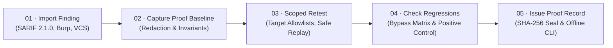

<div align="center">


<br>

> **“A closed ticket is not proof that the risk has been eliminated.”**

<br>


[**Why**](#-why-prooflayer) ·
[**Lifecycle**](#-the-5-step-remediation-lifecycle) ·
[**Capabilities**](#-core-capabilities) ·
[**Verify a record**](#-verify-a-proof-record-offline) ·
[**Quick start**](#-quick-start) ·
[**Tests**](#-test-suite)

</div>

<br>

ProofLayer is a vendor-neutral, evidence-based verification layer for the whole security remediation lifecycle. It captures baseline exploit evidence, enforces deterministic security invariants, checks for naive-fix regressions and alternate attack paths, and issues audit-ready cryptographic proof records.

---

## 🎯 Why ProofLayer

A penetration test reports 30 vulnerabilities. Developers fix them and close the tickets. But did the fixes work?

A patch can stop the original attack and leave a second route open. A scanner can go quiet without the risk going away. ProofLayer replaces “we fixed it” with something you can check.

| The usual workflow | With ProofLayer |
| :-- | :-- |
| Scanner finds a vulnerability | Import it and preserve the original evidence |
| Developer marks it fixed | Independently retest the relevant security behavior |
| Tester re-checks by hand | Run scoped, repeatable assertions and a bypass matrix |
| Ticket closes | Issue an evidence-backed proof record |
| Auditor trusts the report | Verify the record offline, with no dashboard or database |

---

## ⚡ The 5-Step Remediation Lifecycle



<table>
<tr>
<td width="60"><h3>01</h3></td>
<td><b>Import a finding.</b> Ingest SARIF 2.1.0, Burp Suite, or GitHub/Jira webhooks and keep the full source provenance: scanner version, rule ID, code snippet and line ranges.</td>
</tr>
<tr>
<td><h3>02</h3></td>
<td><b>Capture the original proof.</b> Secrets and PII are redacted automatically (Bearer JWTs, AWS keys, session cookies, credit cards), with deterministic hash placeholders so results stay reproducible.</td>
</tr>
<tr>
<td><h3>03</h3></td>
<td><b>Verify the fix.</b> Run approved, scoped retests that are guarded against SSRF and cloud-metadata access.</td>
</tr>
<tr>
<td><h3>04</h3></td>
<td><b>Check for regressions.</b> Did the patch break legitimate workflows, or leave an alternate path open? ProofLayer tries HTTP verb tunneling, path normalization, header spoofing and parameter pollution.</td>
</tr>
<tr>
<td><h3>05</h3></td>
<td><b>Issue a proof record.</b> Seal the record cryptographically, then verify it offline from the CLI (<code>npm run verify</code>) without trusting a dashboard or database.</td>
</tr>
</table>

---

## 🛡️ Core Capabilities

### 1 · Three decoupled assessment fields

ProofLayer never squeezes a result into one confidence score. Every assessment shows three separate fields:

| Field | What it tells you |
| :-- | :-- |
| **Verdict** | The plain-language outcome of the remediation |
| **Assertion coverage** | How many applicable deterministic assertions passed or failed, for example `6/6 Invariants Passed` and `9/9 Bypass Permutations Blocked` |
| **Conclusion confidence** | Why the engine reached its conclusion, without mixing up confidence in a failure with confidence in a fix |

<details open>
<summary><b>Possible verdicts</b></summary>

<br>

| Verdict | Meaning |
| :-- | :-- |
| 🟡 `VERIFIED_REMEDIATED` | The fix holds, and every applicable assertion passed |
| 🟠 `BYPASS_DETECTED` | The original attack fails, but an alternate path still works |
| 🔴 `VULNERABILITY_PERSISTS` | The original issue still reproduces |
| 🟣 `FUNCTIONAL_REGRESSION` | The patch broke legitimate behavior |
| ⚪ `INCONCLUSIVE` | The test couldn’t decide, so it doesn’t guess |

</details>

### 2 · Hardened retest engine and scope guard

> [`server/scopeGuard.js`](server/scopeGuard.js)

- **Target allowlisting.** Strict domain allowlists and permitted protocols (`http:`, `https:`) only.
- **SSRF and cloud-metadata defense.** Requests to `169.254.169.254`, `metadata.google.internal` and private RFC 1918 subnets are blocked.
- **Production safeguards.** Live production retests need an explicit authorization token, and destructive HTTP methods (`DELETE`, `DROP`) are refused.
- **Honest failure handling.** Network dropouts, connection resets and 5xx crashes are marked `INCONCLUSIVE`, never assumed to be a pass.

### 3 · Independently verifiable proof records

> [`server/crypto.js`](server/crypto.js) · [`bin/verify-proof.js`](bin/verify-proof.js)

- Canonical **RFC 8785** JSON hashing binds the finding metadata, baseline evidence, retest evidence, invariants, regression permutations, environment tier, test-suite version and reviewer sign-off.
- A **standalone offline CLI** lets any auditor check a record without trusting ProofLayer’s servers.
- **Limitations are written into every certificate:**

> _“This cryptographic record establishes tamper-evident provenance and integrity of the recorded test execution. It does not certify absence of other undiscovered vulnerabilities or environment drift outside the recorded scope.”_

### 4 · Real integrations

> [`server/integrations.js`](server/integrations.js)

- **SARIF 2.1.0 and Burp.** Preserves rule ID, tool version, source file URI, line numbers and the raw scanner alert message.
- **GitHub PR and Jira webhooks.** Developers trigger a retest from a pull-request comment:

  ```text
  /prooflayer retest PL-FIND-001 --env staging
  ```

  ProofLayer runs the retest and replies with an audit breakdown and a link to the verifiable proof record.

### 5 · Automatic secret and PII redaction

> [`server/redaction.js`](server/redaction.js)

Tokens, Bearer keys, AWS keys (`AKIA…`), cookies and credit cards are masked, and each gets a reproducible hash signature:

```text
[REDACTED_JWT_TOKEN:sha256:24ad12d2]
```

---

## 🔏 Verify a proof record offline

You don’t need the dashboard, the database, or an account.

```bash
npm run verify -- path/to/proof.json
# or
node bin/verify-proof.js path/to/proof.json
```

A valid record exits with code `0`. A tampered one is rejected with code `2`.

---

## 🚀 Quick start

```bash
# 1. Install dependencies
npm install

# 2. Build the frontend assets
npm run build

# 3. Start the verification engine and the target sandbox
npm run server
```

Then open **<http://localhost:3001>**.

---

## 🧪 Test suite

```bash
npm test
```

The end-to-end suite lives in [`tests/prooflayer.test.js`](tests/prooflayer.test.js) and covers the core requirements:

| # | Case | What it proves |
| :-: | :-- | :-- |
| 1 | **Redaction** | Bearer tokens, AWS keys, cookies and credit cards are masked |
| 2 | **Scope guard** | Unauthorized hosts, cloud-metadata SSRF and unauthorized production retests are blocked |
| 3 | **Vulnerable target** | Verification fails with `VULNERABILITY_PERSISTS` and names the specific data leaks |
| 4 | **Naive, bypassable patch** | Verification fails with `BYPASS_DETECTED` and names the verb-tunneling or header-bypass vectors |
| 5 | **Genuinely fixed target** | Verification passes with `VERIFIED_REMEDIATED` and 100% assertion coverage |
| 6 | **Proof integrity** | Sealed records verify, and a single-byte change is detected |
| 7 | **Standalone CLI** | `bin/verify-proof.js` accepts valid records (exit 0) and rejects tampered files (exit 2) |

---

## 🗂️ Key files

```text
ProofLayer/
├── bin/
│   └── verify-proof.js      # standalone offline verifier
├── server/
│   ├── scopeGuard.js        # allowlists, SSRF and metadata defense
│   ├── crypto.js            # canonical hashing and sealing
│   ├── integrations.js      # SARIF, Burp, GitHub and Jira
│   └── redaction.js         # secret and PII masking
└── tests/
    └── prooflayer.test.js   # end-to-end test suite
```

---

## ⚠️ What a proof record does and doesn’t mean

A sealed record shows that **this test ran against this scope and produced this evidence, and that nothing has been altered since.** It does not show that the application has no other vulnerabilities, or that the environment hasn’t changed outside the recorded scope. Treat it as strong evidence about one fix, not a certificate of overall security.

<br>

<div align="center">

**A fix is a claim until it’s proven.**

</div>
