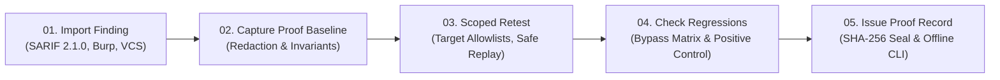

# ProofLayer — The System That Proves Security Fixes Actually Worked

> **"A closed ticket is not proof that the risk has been eliminated."**

ProofLayer is a vendor-neutral, evidence-based verification layer across the entire security remediation lifecycle. It captures baseline exploit evidence, enforces deterministic security invariants, checks for naive-fix regressions and alternate attack paths, and issues audit-ready cryptographic proof records.

---

## ⚡ The 5-Step Remediation Lifecycle



1. **Import a Finding**: Ingest findings from SARIF 2.1.0, Burp Suite, or GitHub/Jira webhooks while preserving full source provenance (scanner version, rule ID, source code snippet, line ranges).
2. **Capture Original Proof**: Redact secrets & PII automatically (Bearer JWTs, AWS keys, session cookies, credit cards) while computing deterministic hash placeholders for reproducibility.
3. **Verify the Fix**: Run approved, scoped retests guarded against SSRF and cloud metadata access.
4. **Check for Regressions**: Test whether the patch broke legitimate workflows or left an alternate attack path (HTTP verb tunneling, path normalization, header spoofing, parameter pollution).
5. **Issue a Proof Record**: Cryptographically seal the record and verify it offline via CLI (`npm run verify`) without trusting a dashboard or database.

---

## 🛡️ Core Capabilities

### 1. Trustworthy, Decoupled Assessment Metrics
ProofLayer eliminates misleading confidence indicators by displaying three strictly decoupled fields:
- **Verdict**: Plain-language remediation outcome (`VERIFIED_REMEDIATED`, `BYPASS_DETECTED`, `VULNERABILITY_PERSISTS`, `FUNCTIONAL_REGRESSION`, `INCONCLUSIVE`).
- **Assertion Coverage**: Number of applicable deterministic assertions passed or failed (e.g., `6/6 Invariants Passed`, `9/9 Bypass Permutations Blocked`).
- **Conclusion Confidence**: Plain-language explanation of why the engine reached this conclusion without confusing confidence in a failure with confidence in a fix.

### 2. Hardened Retest Execution Engine & Scope Guard ([`server/scopeGuard.js`](file:///home/sesame-ai/ProofLayer/server/scopeGuard.js))
- **Target Allowlisting**: Enforces strict domain allowlists and permitted protocols (`http:`, `https:`).
- **Cloud Metadata & SSRF Defense**: Blocks requests to cloud metadata (`169.254.169.254`, `metadata.google.internal`) and private RFC1918 subnets.
- **Production Safeguards**: Live production retests require explicit authorization tokens and strictly disallow destructive HTTP methods (`DELETE`, `DROP`).
- **Inconclusive Handling**: Network dropouts, connection resets, or 5xx server crashes are marked `INCONCLUSIVE`, never assumed to be verified.

### 3. Independently Verifiable Proof Records ([`server/crypto.js`](file:///home/sesame-ai/ProofLayer/server/crypto.js) & [`bin/verify-proof.js`](file:///home/sesame-ai/ProofLayer/bin/verify-proof.js))
- Canonical RFC 8785 JSON hashing binds finding metadata, baseline evidence, retest evidence, invariants, regression permutations, environment tier, test suite version, and reviewer sign-off.
- **Standalone Offline CLI**: Any auditor can verify records offline:
  ```bash
  npm run verify -- path/to/proof.json
  # or
  node bin/verify-proof.js path/to/proof.json
  ```
- **Inspectable Limitations**: Every certificate explicitly states:
  > _"This cryptographic record establishes tamper-evident provenance and integrity of the recorded test execution. It does not certify absence of other undiscovered vulnerabilities or environment drift outside the recorded scope."_

### 4. Real Integrations: SARIF, Burp, & GitHub/Jira Webhooks ([`server/integrations.js`](file:///home/sesame-ai/ProofLayer/server/integrations.js))
- **SARIF 2.1.0 & Burp Provenance**: Preserves scanner rule ID, tool version, source file URI, line numbers, and raw scanner alert message.
- **GitHub PR & Jira Webhooks**: Developers trigger automated retests via PR comments:
  ```text
  /prooflayer retest PL-FIND-001 --env staging
  ```
  ProofLayer executes the retest and replies with an audit breakdown and verifiable proof record link.

### 5. Automated Secret & PII Redaction ([`server/redaction.js`](file:///home/sesame-ai/ProofLayer/server/redaction.js))
- Automatically redacts sensitive tokens, bearer keys, AWS keys (`AKIA...`), cookies, and credit cards while generating reproducible hash signatures (`[REDACTED_JWT_TOKEN:sha256:24ad12d2]`).

---

## 🧪 Automated End-to-End Test Suite

Run the full automated test suite covering all core requirements:

```bash
npm test
```

### Verified Test Cases (`tests/prooflayer.test.js`):
1. **Redaction**: Masks Bearer tokens, AWS keys, cookies, and credit cards.
2. **Scope Guard**: Blocks unauthorized hosts, cloud metadata SSRF, and unauthorized production retests.
3. **Outcome A (Vulnerable Target)**: Fails verification with `VULNERABILITY_PERSISTS` and identifies specific data leaks.
4. **Outcome B (Naive / Bypassable Patch)**: Fails verification with `BYPASS_DETECTED` and identifies verb tunneling / header bypass vectors.
5. **Outcome C (Genuinely Fixed Target)**: Passes verification with `VERIFIED_REMEDIATED` and 100% assertion coverage.
6. **Cryptographic Proof Integrity**: Sealed records pass verification; single-byte tampering is immediately detected.
7. **Standalone CLI Verification**: `bin/verify-proof.js` verifies valid records (exit code 0) and rejects tampered files (exit code 2).

---

## 🚀 Running the Web Application

```bash
# 1. Install dependencies
npm install

# 2. Build frontend assets
npm run build

# 3. Start ProofLayer Verification Engine & Target Sandbox
npm run server
```

Open **`http://localhost:3001`** in your browser.
